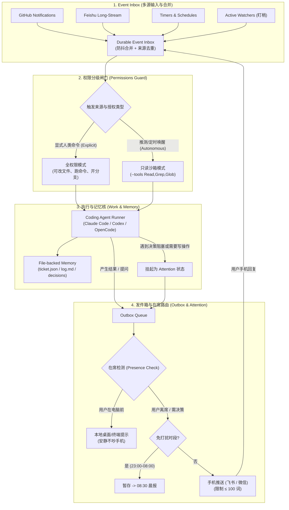

# 借鉴 Anthropic《Building always-on agents》与 Super-Agent 思想完善 superagent

> 本文档深入参考 Anthropic 官方指南 [《Building always-on agents》](https://claude.com/resources/articles/building-always-on-agents)（William Hu，2026年11月13日）、DeepSeek Harness 团队的《Super-agent设计探索：迈向更自主的Agent系统》以及 FanBox 的工程落地实践，系统剖析常驻（always-on）自主 Agent 的架构精髓，并为本项目 `superagent` 提供全方位的演进与升级方案。

---

## 一、核心共鸣：常驻不是一直在线，瓶颈是人的注意力

### 1. “常驻”的本质是离散的状态机循环
Anthropic 在原文中一针见血地指出：
> **“常驻 agent 其实并不‘一直在线’，那只是对用户体验的描述。实际上它大部分时间在睡觉，不花任何 token。隔一阵被某件事叫醒，干一小段活，把发生了什么存下来，再回去睡。”**

这一 **Wake（唤醒） $\rightarrow$ Work（干活） $\rightarrow$ Write Back（存盘） $\rightarrow$ Sleep（休眠）** 的模式，与 `superagent` 从诞生之初就坚持的哲学**完全吻合**：
- **无常驻重型后台 Daemon**：无臃肿进程，每一次触发或轮询都是短生命周期的安全状态转换。
- **文件持久化状态（File-backed State）**：不需要庞大的数据库，纯 JSON/Markdown 文件承载所有记忆、Ticket 与决策，`ls` 和 `cat` 即可随时审计。
- **无供应商绑定**：执行器（Claude Code / Codex / OpenCode）即插即用。

### 2. 核心约束：人的注意力瓶颈与通信带宽
正如 DeepSeek Harness 与 Anthropic 共同发现的：
> **“单任务的上限取决于模型能力，多任务的上限取决于人的注意力。”**
> **“发太多的 agent 变得吵，发得不够的 agent 会漏掉用户需要知道的事。实践中，让 agent 从安静开始，再慢慢赢得用户更多的注意力。”**

构建一个优秀的常驻 Agent，最关键的不是让它有多“活跃”，而是**如何克制、安全、低成本地为人类创造价值**。

---

## 二、Anthropic 五大核心原语在 `superagent` 中的诊断与映射

Anthropic 将始终在线的 Agent 外部架构归纳为五大基础构件（Five Primitives）。下表总结了 Anthropic 的原语定义、`superagent` 当前现状以及本次演进方案：

| 构件 (Primitive) | Anthropic 定义与核心挑战 | superagent 现状 | 本次演进与增强方案 |
| :--- | :--- | :--- | :--- |
| **1. Event Inbox<br>(事件收件箱)** | 解耦外部触发与执行。杜绝并发竞争、状态丢失；支持按来源去重与多消息防抖合并（Burst Coalescing）。 | 具备 GitHub 轮询通知与飞书事件流长连接，由 `intake` 判定；但事件源未统一为统一收件箱抽象，缺少短时间内连续消息合并防抖。 | **统一抽象 Event Inbox**：将 GitHub、Feishu、定时器、外部 Webhook/脚本事件统一排队；增加会话防抖合并（Coalescing），连续发言并为一轮。 |
| **2. Timers<br>(定时器)** | 赋予 Agent 主动性：<br>1) **自主跟进 (Follow-up)**：自己定时间检查某任务（如20分钟后看测试）；<br>2) **周期任务 (Schedule)**：每日晨报、定时巡检。到期产生 Inbox 事件。 | 仅有静态的 `github.pollSeconds` 和飞书 stream idle 超时，**完全缺乏 Agent 自定义定时器和周期 Cron 机制**。 | **引入轻量持久化 Timers 引擎**：支持 Ticket 级别的自主 Follow-up（如检查 CI/PR 状态）与周期性 Schedule（如每日晨报、定时巡检），到期作为事件推入收件箱。 |
| **3. Memory<br>(记忆与状态)** | 跨会话持久上下文。只存查不到的东西与外部指针；记录“已经向用户汇报过什么”，防止重复打扰；防止未授权事件污染长期记忆。 | 具备规范的文件状态（`ticket.json`、`log.md`、`decisions`、`threads`），具备良好的可读性。 | **增加认知记忆防护与防复读指针**：明确记录“已通知用户的事项（Notified Registry）”；严禁在未授权的自主唤醒中写入持久全局记忆（Memory Isolation）。 |
| **4. Permissions<br>(分级权限与安全)** | 无人盯防时的安全防线：凭证代理、动作分类器、高危操作挂起等待确认（Human-in-the-loop）。 | 具备 `worker-bin` 隔离脚本与 `blockedCommands` 禁用列表，但执行模式只有一档（全权限执行）。 | **确立“分级执行安全边界”**：实现“没人叫它时只能看（Read-only Tools）”；写操作/分支合并/高危指令必须通过 `attention` 经人类确认后升级权限。 |
| **5. Outbox<br>(发件箱与注意力)** | 结果可靠投递、网络重试幂等；从安静开始（Start Quiet）；通道带宽控制（IM 单次 ≤ 100 词）；在席感知分流。 | 具备 Outbox 幂等队列；`deliverable()` 取首句且截断至 200 字符。 | **升级注意力管理与在席路由**：集成 Mac/系统在席感知（键盘鼠标活跃度）；免打扰时段（23:00-08:00）静默并聚合为晨报；单日唤醒上限与冷却限流。 |

---

## 三、四大核心实践经验在 `superagent` 中的具体落地

结合 FanBox 落地过程中踩到的 4 个关键坑点，我们为 `superagent` 设计了切实可行的增强策略：

### 1. 规则一：无人触发的那一轮，只给看，不给动（Read-Only Autonomy）
- **问题根源**：常驻 Agent 很容易被公开 GitHub Issue、群聊闲聊、外部 Webhook 唤醒。如果唤醒时直接赋予改代码、跑命令的全权限，极易遭遇 Prompt Injection（提示注入攻击），诱导 Agent 执行恶意代码或删除文件。
- **落地方案**：
  - **显式人机命令（Explicit）**：由白名单用户直接 @ 或私聊的 Ticket，启动全权限 Runner。
  - **自主/推测执行（Inferred / Timer / Watcher）**：
    - 执行器强制注入只读工具集（例如 Claude Code 使用 `--tools Read,Grep,Glob`）。
    - 允许只读分析、定位 Bug 或在本地隔离 Worktree 运行只读测试。
    - **严禁向主分支 Push、严禁向持久记忆写全局配置、严禁执行破坏性系统命令**。
    - 一旦需要改动，在飞书/微信生成结构化的 `attention` 询问，等待人类回复；一旦人类回复（进入 Explicit 状态），下一轮才解锁全套工具。

### 2. 规则二：系统判定在席状态，别让 Agent 自己猜（Presence-Aware Router）
- **问题根源**：提示词中写“如果他在电脑前就提示，不在就发手机”，模型根本无法感知人类是否离开屏幕，最终导致该发的不发、不该发的狂发。
- **落地方案**：
  - **系统级空闲检测（Presence Detection）**：
    - macOS 下使用原生命令获取空闲时间（无键鼠输入秒数）：
      ```sh
      ioreg -c IOHIDSystem | awk '/HIDIdleTime/ {print int($NF/1000000000); exit}'
      ```
    - Linux 下使用 `xprintidle` 或检查终端 tty 活跃时间。
  - **双通道智能分流（Smart Channel Routing）**：
    - **用户在电脑前（系统空闲 < 300秒）**：手机保持安静，仅在终端控制台或桌面通知中心（如 `osascript -e 'display notification ...'`）提示，不打扰手机。
    - **用户离席（系统空闲 ≥ 300秒）**：将关键消息路由至移动端（飞书机器人 / 微信推送）。
  - **夜间免打扰聚合（Quiet Hours Batching）**：
    - 每日 `23:00 - 08:00` 期间，非致命阻塞消息一律暂存。
    - 次日早晨 `08:30` 唤醒时并成一条统一晨报推送到手机。

### 3. 规则三：醒来是有成本的（Token & Wakeup Guard）
- **问题根源**：一次唤醒模型评估或执行哪怕耗时仅数秒，折算 API 成本或会话配额（尤其是 Opus/Sonnet 级别长程上下文）也是实打实的。如果事件源频繁触发，配额很快会见底。
- **落地方案**：
  - **最小唤醒冷却时间（Min Cooldown）**：自主唤醒之间强制设置最小冷却（例如默认 3 分钟），防止外部高频事件引发唤醒风暴。
  - **每日自主配额上限（Daily Wakeup Cap）**：限制每日自主触发上限（例如每天最多 48 次）。达到上限后，除非白名单用户显式 @，否则不再自主唤醒。
  - **评估层轻量化**：对于群聊中的未 @ 消息，优先通过本地正则/静态规则预筛（Gate 阶段过滤 80% 闲聊），仅把高质量候选交给模型判定。

### 4. 规则四：主动盯梢机制（Watchers / Pull-based Event Poller）
- **问题根源**：很多场景没有实时 Webhook（例如团队没有权限给公共仓库配置 Webhook、飞书文档评论、外部构建页面等），必须依靠轮询。但无休止的高频全量轮询既卡顿又耗费资源。
- **落地方案**：
  - 在 `settings.yaml` 中引入 `watchers` 配置节。
  - 允许配置轻量探测命令（如 `gh pr list --state open`、`git fetch` 等）。
  - 每隔设定周期（如 5-10 分钟）运行一次，对比输出指纹（Hash/Diff），**仅当出现新增行或状态变更时，才生成一个合成 Trigger 投递给 Event Inbox**。

---

## 四、架构升级设计与配置规范

为了让这些思想在 `superagent` 中系统化落地，我们规划了清晰的配置与模块扩展规范：

### 1. `settings.yaml` 增强配置设计

```yaml
# ==========================================
# 基础配置保持向后兼容
# ==========================================
stateDir: /Users/smallnest/ai/superagent/.superagent
checkout: /Users/smallnest/ai/superagent

github:
  enabled: true
  repository: smallnest/superagent
  cli: gh
  pollSeconds: 60
  allowed: [smallnest]

feishu:
  enabled: true
  cli: lark-cli
  chats:
    - chatId: oc_xxx
      name: Team
  syncChat: oc_xxx
  directMessages: true

# ==========================================
# 新增：Anthropic Always-On 增强构件
# ==========================================

# 1. 在席感知与注意力预算 (Attention & Presence)
attention:
  # 在席判断阈值（秒）：低于此时间认为用户在电脑前
  idleSecondsThreshold: 300
  # 免打扰时段（24小时制）：在此期间不向移动端发送响铃消息
  quietHours:
    enabled: true
    start: "23:00"
    end: "08:00"
    # 次日聚合晨报发送时间
    morningDigestAt: "08:30"
  # 移动端通知限频
  minNotifyIntervalMinutes: 10
  maxDailyNotifications: 25

# 2. 成本与自主唤醒护栏 (Wakeup & Token Guard)
budget:
  # 两次自主唤醒（非人主动 @）之间的最小冷却时间（秒）
  autonomousCooldownSeconds: 180
  # 每日最大自主唤醒次数
  maxAutonomousWakesPerDay: 48

# 3. 自主定时器与巡检计划 (Timers & Schedules)
timers:
  enabled: true
  schedules:
    # 周期性巡检任务：每日早晨汇总进度
    - id: daily-standup
      cron: "0 9 * * *"
      prompt: "检查当前所有 open 和 active 的 Ticket，生成一句话进度总结发到群聊。"
    # 定期代码库健康巡检
    - id: repo-hygiene
      intervalMinutes: 120
      prompt: "检查未解决的失败 CI 与积压的待办 Ticket。"

# 4. 主动“盯梢”观察器 (Watchers)
watchers:
  - id: watch-prs
    intervalMinutes: 10
    command: "gh pr list --repo smallnest/superagent --state open --json number,title,updatedAt"
    instruction: "当发现有新的 PR 或 PR 更新时，唤醒并做只读代码审查。"
```

### 2. 状态机与处理管线升级

升级后的管线形成闭环，完美契合 Anthropic 的五原语循环：



---

## 五、实施落地路线图

为确保项目的稳健演进，建议分三个阶段进行增强落地：

### 第一阶段：安全与注意力防线（快速收益，立刻减少噪音）
1. **Outbox 在席感知与免打扰**：
   - 增加空闲时间检测模块（Mac 上检测 `HIDIdleTime`）。
   - 在 `send()` 环节增加在席分流：人在电脑前时，只打本地日志或终端提示；人离开才调飞书发给手机。
   - 增加夜间静默时间窗口过滤。
2. **自主模式只读约束**：
   - 在 `assessing.ts` 与执行器参数中，对于 `inferred` 决策初始执行或推测评估，添加工具约束说明，杜绝非授权写入。

### 第二阶段：Timers 引擎与自主跟进（从被动走向主动）
1. **轻量持久化 Timer 存储**：
   - 在 `.superagent/timers/` 下维护到期任务描述文件。
   - 扩展轮询主循环：每一轮检查是否有 Due 的 Timer，有则转换为 Trigger 注入引擎。
2. **Ticket 自主 Follow-up**：
   - 允许 Agent 在 `.superagent/report.json` 中声明 `followupAfterSeconds: 1200`（如20分钟后巡检）。
   - 到期后自动启动只读复查，发现异常再通过 `attention` 唤醒人类。

### 第三阶段：Watchers 机制与预算熔断（健全运维保障）
1. **配置驱动的 Watchers**：
   - 实现轻量级的 `watchers` 轮询执行器，通过哈希比对自动捕获无 Webhook 的第三方事件。
2. **Token 唤醒熔断器**：
   - 记录每日自主唤醒计数器，超出 `maxAutonomousWakesPerDay` 自动切为静默休眠模式，守护用户的账单与配额。

---

## 六、结语

Anthropic 在《Building always-on agents》中倡导的构架，与 DeepSeek Harness 的探索以及 FanBox 的实践，向我们证明了：**真正成熟的 24 小时 Agent 系统，不是让大模型无休止地烧 Token，而是通过精巧、可靠的外层系统架构（Harness），在最合适的时间做最小必要的工作，并用最克制的方式通知人类。**

通过将这五大原语与四项宝贵实践深度融入 `superagent`，本项目将从一个“能帮你在终端跑任务的脚本”，真正跃升为一个**懂安全、知分寸、省算力、可 24 小时托付的专业级 Autonomous Super-Agent**。
